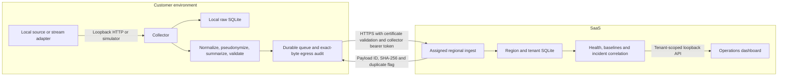

# Cicada Observability

Cicada is a two-tier AIOps prototype for the CICADA 2026 hackathon. A customer-side collector keeps raw telemetry local. An authenticated regional ingest service accepts a small metadata schema and powers tenant-scoped health, incidents and delivery evidence.

## Run locally

Use Node.js 22.13 or newer. The app uses Node's built-in SQLite, HTTP and TLS modules and requires no dependency install.

```powershell
npm.cmd start
```

- [Operations dashboard](http://127.0.0.1:4100)
- [Local collector console](http://127.0.0.1:4101)
- `Ctrl+C` stops both processes. `CICADA_PORT` and `CICADA_TLS_PORT` override the initial ports of the two consecutive port pairs. `CICADA_DATA` selects the data directory, which defaults to `.data`.

Demo mode provisions Northstar Labs and Kepler Systems, starts the labeled simulator, and enables the local workspace switcher and scenario controls. Use `$env:CICADA_DEMO='0'` before starting to disable the simulator, workspace switcher and scenario controls. In that mode, the dashboard asks for a tenant's `viewer` token, and the collector console asks for the `operator` token. The launcher generates those credentials in the local data directory's `installation.json`. Use a fresh data directory for official stream measurements.

## Judge walkthrough

| Scenario | What to show |
| --- | --- |
| Secret handling | In **Local collector**, select **Secret in log**. The synthetic credential and hostname appear in the raw event. The pinned **Egress proof** shows the exact outgoing JSON, its ID and SHA-256. Open the same ID from **Delivery evidence** to match the regional receipt to that proof. |
| Security | Select **Failed logins**. **Incidents** shows the 30-second failure count and suspicious signal. Actor, address and log contents stay in the local console. |
| AIOps and correlation | Select **CPU deviation**, **Latency spike** or **Correlated alerts**. In **Incidents**, inspect the observed values, baseline deviations, affected source and recommendation. Repeated signals appear together as evidence for an incident. |
| Delivery and stale health | Select **Disconnect uplink**. Watch the queue grow locally and the heartbeat become stale after 15 seconds. At around 50 seconds, the SaaS shows the collector as offline. Select **Reconnect uplink** and compare the outage replay count and the regional receipt IDs. |
| Idempotency and ordering | Select **Duplicate delivery** and check that the receipt's retry count increases on the existing ID. Select **Late event** and inspect its position on the event-time chart rather than at the right edge. |
| Multi-tenancy | Switch workspaces in the simulator and inspect the separate environments and ingest regions. In token mode each viewer token opens only its assigned tenant. |
| Assisted remediation | In an incident, propose, approve and run the simulation, then simulate rollback. Each transition is recorded in the incident audit trail. The simulation ledger has no command runner or infrastructure access. |

Keep the dashboard **Overview** visible during the latency test. After readings have appeared, open **Delivery evidence**. The collection p95 uses the event timestamp and the server's receipt time for the browser acknowledgement, sent after rendering. This is a conservative estimate of display latency. It samples displayed latest readings and excludes events whose event timestamp differs from payload preparation by over five seconds. Breach to alert uses the original event timestamp and alert creation time. It includes late or buffered alerts that can exceed the live target. Offline detection is the interval from the last heartbeat to the observed offline transition. Both the collector queue and SaaS receipts are keyed by payload ID.

## Organizer stream

The organizer dataset and schema were absent from the attached guide. Map its records to the collector's NDJSON format when available. A source event has an offset-bearing timestamp, a source identifier, an optional IANA timezone, and a metrics object or local security event kind. Additional input fields are stored on the collector and dropped at egress.

```json
{"at":"2026-11-20T09:00:00.000Z","zone":"Asia/Kolkata","source":"gateway-01.internal","metrics":{"cpu":41,"memory":55,"disk":46,"bandwidth":240,"latency":32,"loss":0.3,"connected":1,"available":1},"message":"Local record"}
{"at":"2026-11-20T09:00:01.000Z","zone":"Asia/Kolkata","source":"gateway-01.internal","kind":"auth_failure","actor":"local-demo-user"}
```

```powershell
npm.cmd run replay -- .\organizer.ndjson mumbai --rebase
```

`CICADA_SIMULATOR=0` disables the background simulator and keeps the demo controls available for interactive judging. Set it before starting the app.

`--rebase` shifts the first event to the current time and preserves relative event times, late timestamps and input order. Omit it to preserve the original UTC times. Live adapters can POST `{"events":[...]}` to `/api/events?site=mumbai` on the collector with up to 200 events per call. Supported demo site IDs are `mumbai`, `singapore`, `sydney`, `frankfurt` and `dublin`.

## Trust boundary and data flow



The metadata allow-list covers the envelope version, UUID and preparation time, the collector process heartbeat, and signal records with UTC event time, source timezone, HMAC-derived source ID, enumerated metric and bounded numeric value. Site and tenant identities come from the authenticated collector credential. Raw JSON, messages, hostnames, principals, IP addresses and credentials are never fields in the wire schema. Unknown fields fail validation on ingest. See `validEnvelope` in `src/shared.mjs`.

The collector commits raw events and immutable outgoing envelopes in one local SQLite transaction. It retries pending envelopes after reconnect and retains their original bytes and IDs across process restarts. The regional service commits the ID, samples and alerts atomically. Repeated identical bytes receive the prior ID and digest, while a conflicting body is rejected. Heartbeats only advance in event order. Trend queries use event timestamps and the browser can show UTC or source time. Raw and acknowledged audit retention default to 24 hours. Pending envelopes are retained until acknowledged.

Health uses four states. **Excellent** indicates fresh readings within expected ranges. **Good** indicates a minor deviation. **Fair** indicates warnings or stale signals. **Poor** indicates critical severity or an expired collector heartbeat. `settings.json` controls thresholds, retention and the correlation window. AIOps compares readings with a trimmed rolling baseline of up to 24 prior samples, with a minimum spread and eight-sample warmup. It groups warning and critical evidence by site, pseudonymous source and event-time proximity. Confidence describes signal coverage and is heuristic.

## Validation and scope

```powershell
npm.cmd test
```

The test takes about one minute and uses isolated temporary stores. It exercises the exact wire audit, TLS and regional authentication, tenant scoping, auth and resource anomalies, incident approval and rollback, late data, offline detection and ID-by-ID backlog reconciliation.

The prototype runs both tiers and two logical regions on one machine. The tenant stores are separate, and regional routing is enforced at ingest. Geographic residency needs deployment in independently managed regions. A production rollout would also need separate host identities and storage permissions, managed TLS and key rotation, SSO and role-based authorization, regional lifecycle and capacity policies, and adapters for the organization's agents, SNMP, syslog and flow protocols. The implementation accepts JSON telemetry and NDJSON replay. Remediation stays simulated.
